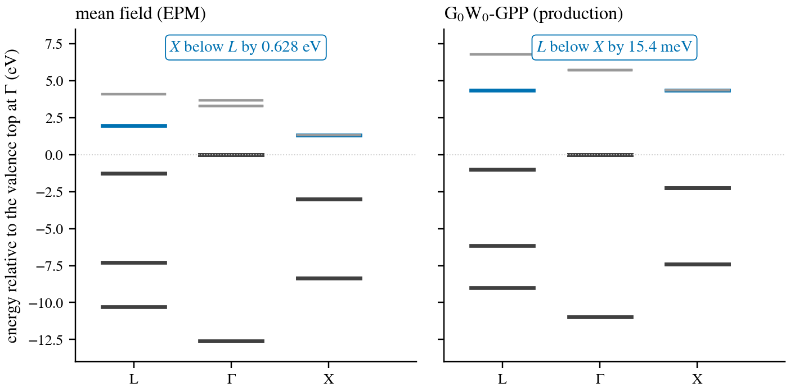
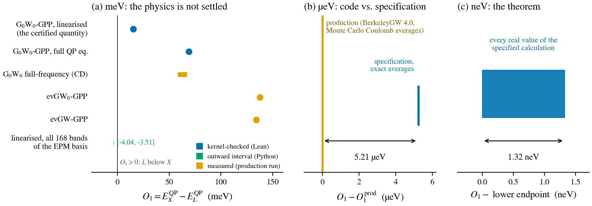
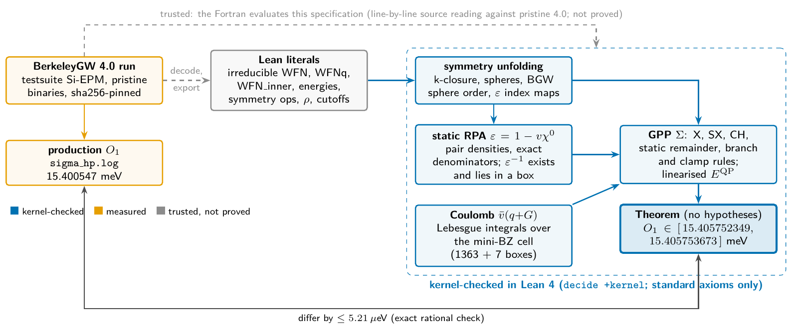
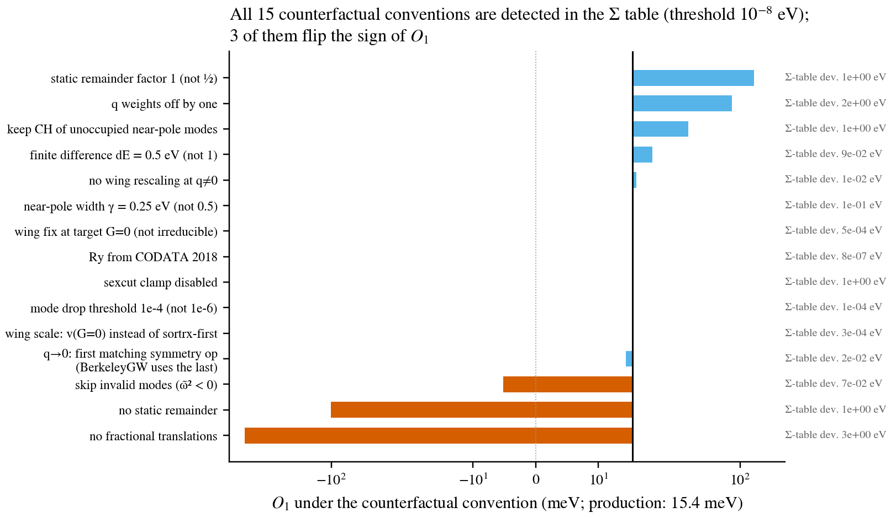
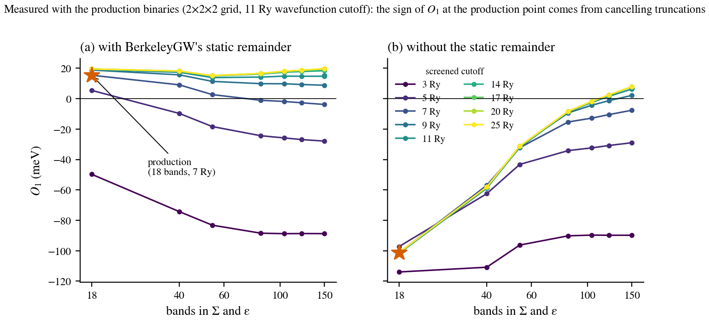

# Notes for BerkeleyGW developers

These notes go with [`slides.pdf`](slides.pdf) (source: [`slides.tex`](slides.tex)). They are
written for a reader who knows BerkeleyGW's GPP path well and has ten minutes. Each section
corresponds to one or two slides. Every number has a label for the kind of evidence behind it:
- **kernel-checked**: a Lean theorem, standard axioms only;
- **interval**: outward-rounded binary64 interval arithmetic in Python, not re-checked in Lean;
- **measured**: a production run or plain floating point.

---

## 0. The question

In BerkeleyGW's own `testsuite/Si-EPM`, G₀W₀ reverses the conduction-band ordering of X and L
(measured, from `sigma_hp.log`). In mean field, X lies 0.628 eV below L. After G₀W₀, L lies
15.4 meV below X. That is a 15 meV effect on self-energies of about 9 eV. Is 15.4 meV exactly
what the code's equations give for this input?

## 1. The result in one figure

The calculation is the shipped `testsuite/Si-EPM` of BerkeleyGW 4.0: GPP, 18 bands, 7 Ry
screened cutoff, real flavour, run with the pristine binaries. The observable is the
conduction-band ordering

$$O_1 = E^{\rm QP}_X - E^{\rm QP}_L ,$$

each energy averaged over its degenerate multiplet.

- **(c) kernel-checked.** The specification, evaluated exactly on the run's own mean-field
  data, gives $O_1 \in [15.405752349,\ 15.405753673]$ meV. The Lean theorem
  (`Headline.o1_enclosure_irr_unconditional`) has no hypotheses.
- **(b) the comparison.** BerkeleyGW prints 15.400547 meV. The two differ by 5.21 µeV, checked
  in exact rationals against the theorem's endpoints. Almost all of the 5.21 µeV comes from
  BerkeleyGW's Monte Carlo Coulomb averages.
- **(a) the physics.** Other treatments of the same deck move $O_1$ by tens of meV. The
  certificate does not adjudicate those; it pins down what the code computes.

## 2. What is proved, and what is trusted

Inside the dashed box, everything is a Lean definition plus a kernel-checked computation:
- the symmetry unfolding from the irreducible wavefunctions, including BerkeleyGW's sphere
  order and the ε index maps;
- static RPA ε from pair densities with exact energy denominators;
- existence of ε⁻¹, and a box that contains it;
- the mini-BZ Coulomb averages, as Lebesgue integrals over the exact cell;
- the GPP self-energy with BerkeleyGW's branch and clamp rules;
- the linearised QP equation.

The certificates are checked with `decide +kernel`. The audit admits only `propext`,
`Classical.choice` and `Quot.sound`.

Three things are trusted, not proved:
1. **Decoding and export of the run files into Lean literals.**
2. **That the Fortran evaluates this specification.** This was checked by reading the source
   line by line against pristine 4.0 on every active path. The generated guide
   [`docs/review/index.html`](../review/index.html) shows each Lean definition next to the
   Fortran it transcribes.
3. **The production execution.**

The 5.21 µeV agreement is evidence for item 2 on this deck. It is not a proof of it.

## 3. The specification reads like `mtxel_cor.f90`

| BerkeleyGW 4.0, occupied GPP branch | Lean (`SigmaSpec.lean`) |
| --- | --- |
| `if (wdiffr.gt.limittwo .and. delwr.lt.limitone) then sch = delw * I_eps` | `if (x - w)^2 > GAM2 ∧ w^2 < (x - w)^2 * LIM1 then w * IeU I / (x - w) else 0` |

The tests are written without division. `certSsx_eq_srcSsx` proves them equivalent to the
source's rule wherever the source's formula is defined. The case `x = ±w` is treated
separately in `CertSexcut.lean`.

## 4. Which conventions decide the answer

Each bar re-evaluates the deck with one documented convention changed; the evidence is
**measured** (the reproducer against production). The reproducer matches production's Σ
table to print precision, so every change is detected at 10⁻⁸ eV. These are not bugs. The
study shows where the sign of $O_1$ lives:
- the static remainder: $O_1 = -101$ meV without it;
- the treatment of invalid modes ($\tilde\omega^2 < 0$): −5.2 meV if they are skipped;
- the fractional translations of diamond.

The same machinery is a regression oracle for convention changes.

**The q → 0 cell (interval).** Σ carries ε⁻¹ to the full q-grid with the space-group formula.
For each q it uses the *last* matching (iq, op) pair; for q = 0 that is op 48 of 48. The head
and wings at q₀ = (0, 0, 0.001) depend on direction, so the code effectively picks one
direction:
- over every direction it could have picked, $O_1 \in [14.34, 15.41]$ meV;
- the direction average gives 14.89 meV;
- exactly degenerate states split; the Γ valence SX−X spreads by 36 meV before the multiplet
  average hides it.

**Other facts that surfaced:**
- The ε k-sum runs over the 32-point closure of the shifted 2×2×2 grid.
- Wings at q ≠ 0 are rescaled through the *irreducible* G = 0 and the sortrx-first v.
- The Monte Carlo averages differ from the exact integrals by up to 1.7 × 10⁻³ (relative) and
  break star symmetry. They move individual QP energies by 0.14–0.18 meV, which largely
  cancels in $O_1$.

## 5. Convergence (measured; no claim made)

125 production runs. At 7 Ry, adding bands drives $O_1$ from +15.4 to −3.8 meV. Raising the
cutoff at 18 bands looks converged. The positive production value comes from two truncation
errors that cancel. The static remainder carries the sign at the production point and
becomes small only as the plane-wave basis completes. This is the coupled bands × cutoff
behaviour known from G₀W₀ convergence studies.

## 6. The GW hierarchy

| treatment | $O_1$ (meV) | evidence |
| --- | --- | --- |
| G₀W₀-GPP, linearised (production) | +15.4 | kernel-checked |
| G₀W₀-GPP, full QP equation | +69.0 | kernel-checked |
| G₀W₀ full frequency (contour deformation) | +58 to +67 | measured |
| evGW₀-GPP | +137.9 | measured |
| evGW-GPP | +134.2 | measured |
| second-order exchange (leading vertex), estimate | +2.0 shift | measured |

With $V_{xc} = 0$, the QP energies sit about 7 eV from the EPM energies, deep inside Σ's pole
structure. One Newton step (the linearisation) moves $O_1$ by −53.6 meV.

It is proved that in [−10⁴, 10⁴] eV each state's full GPP QP equation has exactly two roots,
with Z = 0.86 and 0.04. The principal root is unique only because of the `sexcut` clamp;
without the clamp, X has 11 sign changes. Against contour deformation, the plasmon-pole error
on $\Sigma_c(X) - \Sigma_c(L)$ at $E = E_o$ is −31.6 meV.

## 7. Theory to specification

`GW/Bridge` proves the specification equal to theory-side expressions under named
hypotheses:
- the pole signs from the damped Fourier transform of time-ordered $G_0$;
- the HL-GPP kernel algebra and the SX/CH split;
- the static χ⁰/RPA structure.

Every departure of the code from the theory is listed in the departure table of
[`docs/BRIDGE.md`](../BRIDGE.md). Formalization made several points explicit:
- At q = 0, iω = 0, the argument x is exactly 0 for the state itself. The code substitutes
  `TOL_Zero`, so the identity covers Σ(E_o + dE) but not Σ(E_o).
- The GPP kernel is discontinuous at (x, Ω²) = (0, 0). Modes dropped because rounding makes
  |Ω²| tiny are exactly right only in the ideal metric.
- The one-system theorem cannot be applied at X or L. They are time-reversal-invariant points,
  and this is a formal obstruction (`hyps_unsat_of_selfpaired`).

These identities are not instantiated on the certified run, and they do not derive the GPP
f-sum prescription.

## 8. What is not claimed

- that BerkeleyGW is correct on any other input;
- that its execution stays within 5.21 µeV on other runs;
- that 18 bands are converged;
- that GW, the GPP or the EPM describe silicon;
- formal verification of BerkeleyGW's physics.

The trusted computing base is the Lean 4.19 kernel (including its GMP `Nat`), Mathlib and the
elan installer. No external re-checker such as lean4checker has been run yet.

## 9. What we would like to hear

1. Does the specification match your reading of the code? Corrections to the transcription
   are the most valuable feedback.
2. Which target should come next: LDA $V_{xc}$, the complex flavour, full frequency, or a 2D
   material with Coulomb truncation?
3. Would certified reference values be useful in the testsuite?

## Provenance

The formalization, certificates and analysis code were written by Claude (Anthropic) under
the authors' direction. A separate AI reviewer (Codex) reviewed them. No human maintainer
has audited them.

Figures are generated by [`docs/figures/make_figures.py`](../figures/make_figures.py) from
committed data. The full-frequency $O_1$ values are the one exception: they come from
[`docs/ENDPOINT.md`](../ENDPOINT.md) A2.
